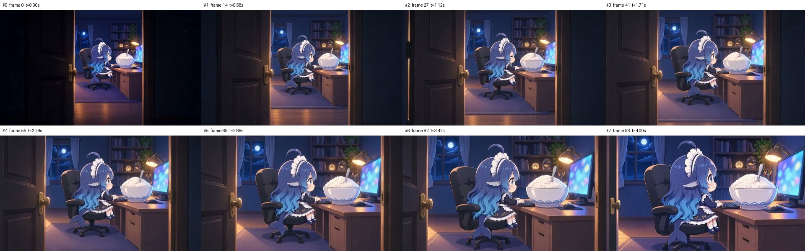

# S01_v5 检查包

- 时长 4.04s，864x496，24.0 fps，共 97 帧，h264
- 音轨：无
- 抽帧亮度：[25.4, 45.7, 52.9, 58.8, 64.7, 72.4, 78.5, 83.9]
- 相邻抽帧差异：[23.2, 15.1, 17.0, 19.4, 22.5, 24.5, 28.2]
- 与 first_frame 原图差异：3.6（images/K0_door_gap_v1_16x9.png）
- 与 last_frame 原图差异：7.3（images/K1_typing_v2_16x9.png）

