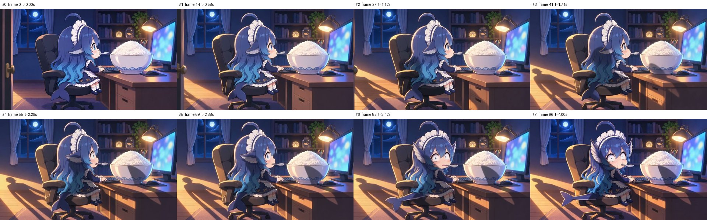

# S04_v3 检查包

- 时长 4.04s，864x496，24.0 fps，共 97 帧，h264
- 音轨：无
- 抽帧亮度：[82.0, 88.8, 90.0, 91.0, 91.1, 91.6, 92.8, 91.6]
- 相邻抽帧差异：[10.8, 11.9, 14.4, 14.1, 2.0, 6.8, 5.0]
- 与 first_frame 原图差异：7.8（images/S04_first_v1_16x9.png）
- 与 last_frame 原图差异：7.2（images/S04_last_v1_16x9.png）

