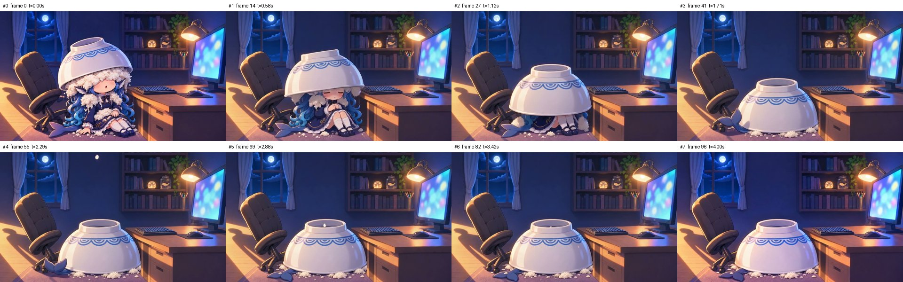

# S06_v3 检查包

- 时长 4.04s，864x496，24.0 fps，共 97 帧，h264
- 音轨：无
- 抽帧亮度：[90.5, 89.4, 89.0, 88.7, 88.9, 89.3, 89.2, 89.6]
- 相邻抽帧差异：[13.9, 13.8, 11.9, 1.6, 1.7, 0.8, 5.4]
- 与 first_frame 原图差异：8.0（images/K4_bowl_head_v1_16x9.png）
- 与 last_frame 原图差异：7.2（images/K5_bowl_cover_v1_16x9.png）

